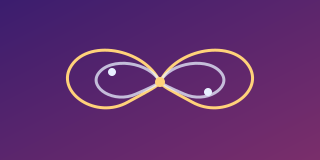
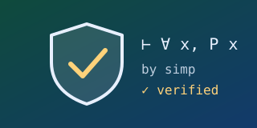
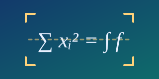

```{=html}
<div class="page-hero">
  <div class="aurora" aria-hidden="true"><span></span><span></span><span></span></div>
  <div id="hero-particles" aria-hidden="true"></div>
  <div class="page-hero-content">
    <p class="page-hero-eyebrow">Projects</p>
    <h1>Open source</h1>
    <p class="page-hero-lead">Machine learning libraries and developer tools I have created.</p>
  </div>
</div>
<section class="landing-section reveal">
<div class="oss-grid">
  <a class="oss-card" href="https://github.com/georgedouzas/sports-betting">
    
    <h3>sports-betting</h3>
    <p>Tools to create and evaluate machine learning models for sports betting, compatible with scikit-learn, with a Python API, CLI and GUI.</p>
  </a>
  <a class="oss-card" href="https://github.com/georgedouzas/imbalanced-learn-extra">
    
    <h3>imbalanced-learn-extra</h3>
    <p>Novel oversampling algorithms for class imbalance, including Geometric SMOTE and clustering-based oversampling.</p>
  </a>
  <a class="oss-card" href="https://github.com/georgedouzas/scikit-ai">
    
    <h3>scikit-ai</h3>
    <p>Task-oriented components for text, images, audio and video with a scikit-learn API, powered by open-source models or cloud APIs.</p>
  </a>
  <a class="oss-card" href="https://github.com/georgedouzas/scikit-complexity">
    
    <h3>scikit-complexity</h3>
    <p>Create and simulate complex systems: describe a model in a few lines, and it works out the mathematics, picks a solver and runs the simulation.</p>
  </a>
  <a class="oss-card" href="https://github.com/georgedouzas/veriphy">
    
    <h3>veriphy</h3>
    <p>Certified computer algebra for Lean 4, with agent skills that turn a physics or math statement into a machine-verified proof.</p>
  </a>
  <a class="oss-card" href="https://github.com/georgedouzas/copier-modern-python">
    
    <h3>copier-modern-python</h3>
    <p>Copier template for modern Python projects.</p>
  </a>
  <a class="oss-card" href="https://github.com/georgedouzas/mathpix-mcp">
    
    <h3>mathpix-mcp</h3>
    <p>MCP server for Mathpix OCR, converting images, PDFs and DOCX/PPTX to LaTeX and Markdown from any LLM or agent.</p>
  </a>
  <a class="oss-card" href="https://github.com/georgedouzas/agentorg">
    
    <h3>agentorg</h3>
    <p>A framework for generating multi-agent organisations powered by Agno.</p>
  </a>
</div>
</section>
```
